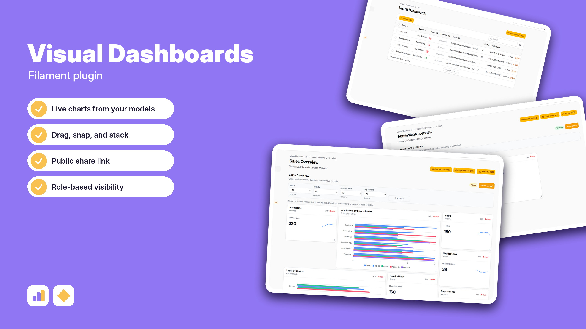
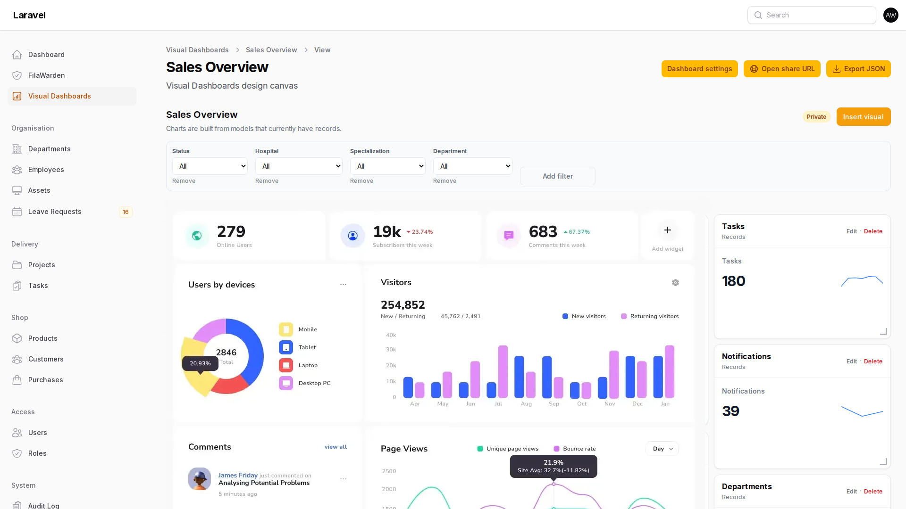

# Spiggle Visual Dashboards

| | |
|---|---|
| **Package** | `spiggle/visual-dashboards` v1.1.0 |

Turn the records already in your app into a dashboard people actually want to open. Pick a model, drop a chart on the canvas, and publish a live page in a few minutes.

## Install

```bash
composer require spiggle/visual-dashboards
php artisan migrate
```

Register the plugin on the panel:

```php
use Spiggle\VisualDashboards\Filament\VisualDashboardsPlugin;

$panel->plugin(VisualDashboardsPlugin::make());
```

Check the install:

```bash
php artisan visual-dashboards:verify
```

## Build a dashboard

1. Open **Visual Dashboards** and create a new dashboard. Name it, then open the canvas.
2. Choose **Insert visual** and pick a chart. Bars work well when you want to compare categories.
3. Set the source category to **Models** and choose the model that holds the records. For the bars, pick the category field. For the length, pick **Row count**, or another measure. Save the chart.
4. Insert a **KPI card** the same way when the page needs a headline number.
5. Drag a card by its header. It snaps into the nearest gap. Drop it on another card to place it in front or behind.
6. Open **Dashboard settings**, turn on **Public link**, and save.
7. Open the share URL. Signed-in allowed viewers can always use it. With the public link on, anyone with the URL can view the page.



## Features

- **Visual Dashboards canvas** — drag, resize, snap into gaps, and stack cards in front or behind
- **Chart gallery** — KPI card, table, line, bar, column, pie, donut, stacked, funnel, radial gauge
- **Live models** — chart fields come from Eloquent models that already have records, including related names
- **Public link** — optional anonymous access at `/visual-dashboards/{id}/{slug}`
- **Viewer roles** — optional Spatie or Shield allowlist for signed-in viewing, including per dashlet
- **One sidebar item** — Visual Dashboards opens the dashboard list
- **Works without Shield** — Spatie or Filament Shield permissions apply when those packages are installed

## Architecture

See [docs/VISUAL_DASHBOARDS.md](docs/VISUAL_DASHBOARDS.md).

## Spiggle plugins

- **[FilaWarden Core](https://github.com/skillbobby/Spiggle-FilaWarden-Core)** — deployment checks, queue and cron health, and production diagnostics inside Filament.
- **[Form Builder Core](https://github.com/skillbobby/Spiggle-Form-Builder-Core)** — public forms, submissions, and CSV export.
- **[Dynamic Fields Core](https://github.com/skillbobby/Spiggle-Dynamic-Fields-Core)** — custom fields on any Eloquent model.
- **[Rules Engine](https://github.com/skillbobby/Spiggle-Rules-Engine)** — event triggers you design in the panel.
- **[List View](https://github.com/skillbobby/Spiggle-List-View)** — switch a Filament table to an alphabetical list.
- **[Portal Snapshot](https://github.com/skillbobby/Spiggle-Filament-Portal-Snapshot)** — schedule, restore, and export database snapshots, including demo resets.

## Sponsors

Support the plugins at [github.com/sponsors/skillbobby](https://github.com/sponsors/skillbobby).

## Contact

[Spiggle on X](https://x.com/iamspiggle)

## License

All rights reserved. You can review this repository and install the package in your own Laravel application. See [LICENSE](LICENSE).
